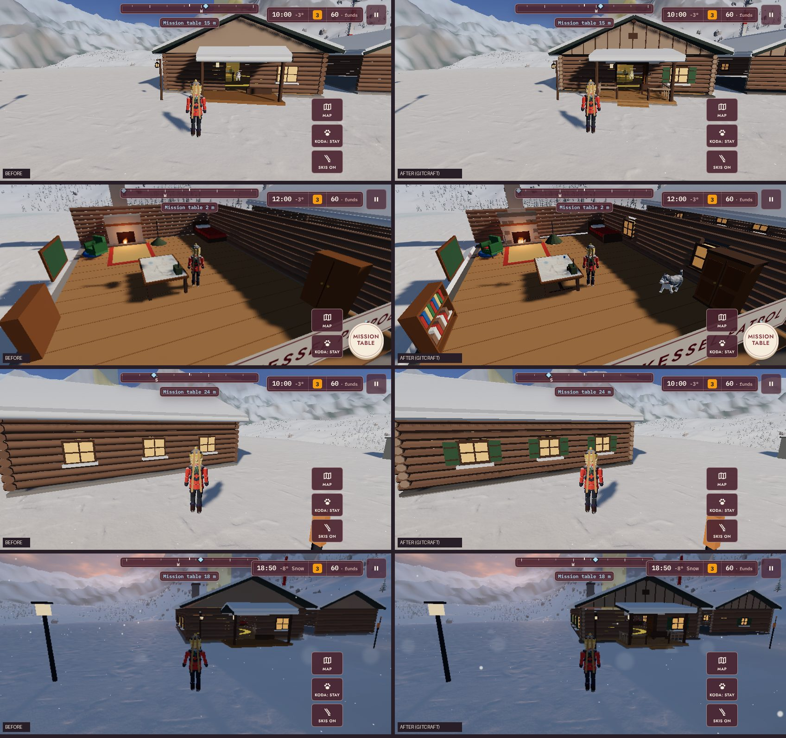
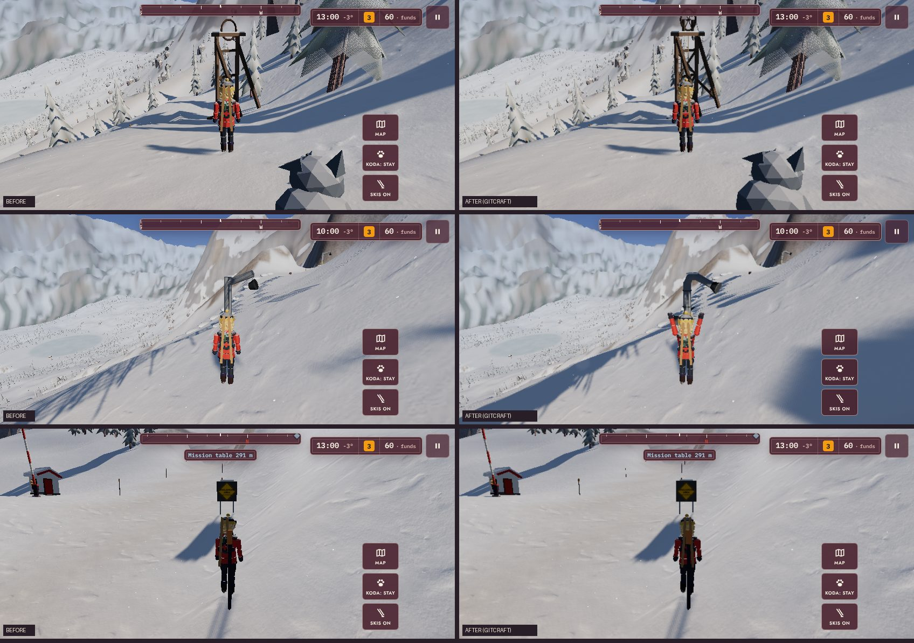
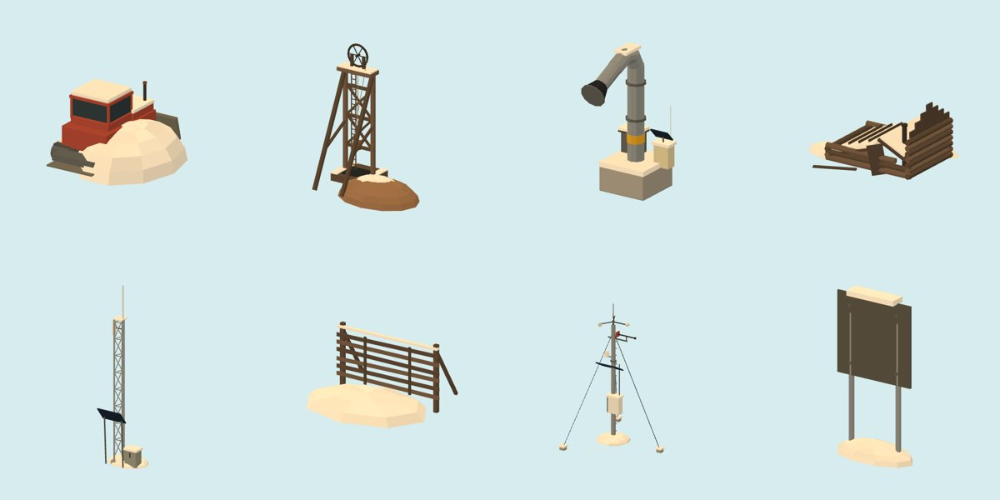

# ROCKSLIDE × GITCRAFT: asset modernization

Branch `claude/gitcraft-modernization`. Not merged or deployed: both wait for approval.

## Where things stood

Most of the valley was already GITCRAFT MeshCraft models before this pass (38 GLBs in `public/models/`:
the sled, helicopter, spruce, patroller, Koda, villagers, Hollin and the Tannberg huts, the station
yard, the mission props, the chairlift and the Kessel kit). The code-built 3D that was left fell into
three groups: the **patrol lodge** (the home base, on the title screen and seen every day), the
**working mountain** in `opsView.ts` (fences, exploders, repeater, signs, snowcat, mine), and a long tail
of small props and gameplay markers.

This pass replaces the first two, plus the weather station the first mission sends you to, and leaves
the tail sorted into what to rebuild next and what should stay code.

## 1. Legacy asset inventory

**REPLACE**: an existing GITCRAFT asset could stand in. None qualified. GITCRAFT's MeshCraft templates
are all nautical (boat, chest, crab, deckhand, flag, island, lantern, lighthouse, prop, sail, salvage,
figurehead), and its shared 3D library was empty in this container. The one earlier match, the
`lantern` template, already ships as `rs_lantern`.

**REBUILD**: rebuilt in this pass with MeshCraft, at the code's own coordinates and sizes:

| Legacy (code) | Where | New model | Nodes |
| --- | --- | --- | --- |
| Lodge shell: log walls, windows, door, roof, gables, porch, chimney | `stationView.ts` `buildLodge` | `rs_lodge` | `base`, `wall_n/s/w/e`, `roof`, `chimney` |
| Lodge wing (upgrade) | `stationView.ts` `buildWing` | `rs_lodge_wing` | `wing` |
| Hearth, mission table, bunk, wardrobe, armchair, shelf, dog bed, lamp | `stationView.ts` `buildLodge` | `rs_lodge_furniture` | one per piece |
| Snow fence (×57 on Kessel Ridge) | `opsView.ts` `fence` | `rs_snow_fence` | `fence` |
| Avalanche exploder (×3) | `opsView.ts` `exploder` | `rs_exploder` | `exploder` |
| Solar radio repeater | `opsView.ts` `repeater` | `rs_repeater` | `repeater` |
| AVALANCHE AREA sign (×2) | `opsView.ts` `warningSign` | `rs_warning_sign` | `sign` |
| Retired snowcat | `opsView.ts` `snowcat` | `rs_snowcat` | `snowcat` |
| Mine headframe | `opsView.ts` `headframe` | `rs_headframe` | `headframe` |
| Collapsed miners' cabin | `opsView.ts` `mineCabin` | `rs_mine_cabin` | `minecabin` |
| Grauhorn weather mast and anemometer | `worldView.ts` `buildWeatherStation` | `rs_weather_mast` | `mast`, `anemometer` |

**REBUILD next**: still code-built, and better as models (priority order in section 8):

| Legacy (code) | Where |
| --- | --- |
| Garage contents: explosives locker, oil drums, workbench, supply crate | `stationView.ts` `buildGarage` |
| Workshop upgrade: tool wall, hoist, tyre stack, work lamp | `stationView.ts` `buildWorkshop` |
| Helipad: deck, ring, H, edge lights, windsock | `stationView.ts` `buildPad` |
| Kennel run fence, bowl, toys | `stationView.ts` `buildKennel` |
| Hangar fuel bowser; equipment-room ski rack and life ring | `stationView.ts` |
| Yard lamp posts, flagpole | `stationView.ts` `buildLights` |
| Hollin street lamps, café tables, wood piles, door sleds, the square's lit spruce | `worldView.ts` `buildVillage` |
| Piste poles, berm marker posts, the ridge cairn | `worldView.ts` |
| Snow poles along the roads (instanced) | `worldView.ts` `buildPoles` |

**PRESERVE**: stays code, on purpose:

| What | Why |
| --- | --- |
| Terrain, snow and rock shader, the eroded range | Procedural by nature, already fed by a GITCRAFT WorldCraft heightfield and Poly Haven scans |
| Avalanche slab blocks and debris (`markers.ts` `AvalancheView`, `sim/fracture.ts`) | Cut at runtime by the Voronoi fracture that is the avalanche simulation |
| The sawn tree's logs (`missionProps.ts`) | Rigid bodies in the debris sim |
| Beacons, scan pins, charge flags, paw prints, rings (`markers.ts`) | Gameplay readouts that need to read flat and bright, not "modelled" |
| Particles, snowfall, ground drift, tracks (`fx.ts`) | Already drawn from the FXCraft flipbook atlas; pooled for phones |
| Hearth flames, glows, lit windows' material, lamp and nav-light glows, the rotor disc, the searchlight | Animated or emissive per frame |
| Painted signs, the mission map sheet, the badge board and its pins, the flag cloth | Canvas textures and per-save state |
| Chairlift cable and chair placement | Computed per frame along the cable |
| Code-built fallbacks behind every model (sled, heli, people, Koda, conifer, buildings, lodge, ops) | Each model is used only when its file loads; the fallback keeps the game whole if one does not, and is covered by tests |

## 2. GITCRAFT compatibility report

- **How GITCRAFT assets are consumed here.** MeshCraft runs a ROCKSLIDE Blender script
  (`art/3d/scripts/*.py`, `run_script`), exports `three-web-toon` GLB (vertex colours, palette roles in
  `extras.gitcraft_role`), validates it (`validate_asset`, Khronos) and checks it in three.js
  (`engine_check`). The game loads the GLB with `GLTFLoader` (`patrolModels.ts`), finds its named nodes
  and paints each role with its own graded material (`paintModel`), so the storybook grade, paint jobs
  and night windows keep working. No new runtime dependency.
- **What GITCRAFT had for this pass.** Kit primitives and the toon pipeline: yes. Alpine or structural
  assets: none. So everything here is a REBUILD, built with the same kit and conventions as the
  earlier ROCKSLIDE models.
- **Gap fed back to GITCRAFT.** Three helpers every one of these scripts needed (log walls with door
  and window openings, snow drifts and heaps, a beam between two points) were missing from MeshCraft's
  kit. They are now in GITCRAFT `meshcraft/engine/kit.py` (`log_wall`, `mound`, `beam`) with
  `tests/test_meshcraft_structural.py` (6/6 through the sandboxed server), on GITCRAFT branch
  `claude/structural-kit-helpers`. ROCKSLIDE's scripts keep their own copies until that is merged and
  installed, then can switch to `kit.log_wall` and friends.
- **Library.** The 3D library in this container is ephemeral (`~/.gitcraft/3d-library`, empty at
  start); the sources and build driver live in this repo so any container can rebuild them:
  `art/pipeline/8_build_models.py <script> <asset> … [--sunk] [--ship]`.

## 3. Migration ledger

| # | Batch | Commit | Models | Fallback | Tests |
| --- | --- | --- | --- | --- | --- |
| 1 | The lodge, its wing and its furniture | `cdf5366` | `rs_lodge`, `rs_lodge_wing`, `rs_lodge_furniture` | all three or the code lodge | `tests/lodge.test.ts` (footprint, height, chimney smoke point, open door, cut-away on all four walls and the roof, furniture heights and spots, the hearth's flame point unchanged and its firebox clear, wing footprint, draw calls, fallback for each missing file) |
| 2 | The working mountain | `6ff5436` | `rs_snow_fence`, `rs_exploder`, `rs_repeater`, `rs_warning_sign`, `rs_snowcat`, `rs_headframe`, `rs_mine_cabin` | per piece | `tests/ops.test.ts` (same draw calls as the code pieces, each site small enough to cull, each kind on its spot at the code piece's height and base, a missing model falls back alone) |
| 3 | The weather station; colour-baking the lodge | `06970df` | `rs_weather_mast` | the code mast | `tests/weather-station.test.ts` (position, height, hub at 7.2 m, the anemometer turns only once repaired) |

Every model also passes MeshCraft `validate_asset` (no failures) and `engine_check`, and is held to a
triangle budget in `tests/models.test.ts`. `art/MANIFEST.json` lists each file with its SHA-256.

What stayed the same in every batch: collision (the station's walls come from `world/colliders.ts`,
the working mountain's circles from `opsObstacles`, unchanged), positions, scale and orientation (each
model is built in the game's coordinates from the code's own numbers), interactions (the mission
table, bunk, wardrobe, badge board and dog bed spots are the same; the hearth's fire point is identical,
checked to 1e-6), the dollhouse cut-away and the anemometer's repair.

## 4. Implementation notes

- `src/render/patrolModels.ts`: `LODGE_IDS`, `OPS_MODELS`, `WEATHER_IDS` join the loaded set.
- `src/render/stationView.ts`: the lodge comes from `rs_lodge` (walls into the cut-away, roof, base,
  chimney) and `rs_lodge_furniture` (each piece placed where the code's group was); the code-built
  shell moved into `codeLodge()` as the fallback. `lodgeModelled` reports which is in use.
- `src/render/opsView.ts`: `buildOps(t, models)` uses a model per kind when present, and bakes per site
  so the camera culls what it cannot see.
- `src/render/worldView.ts`: the weather mast and its spinning anemometer; `weatherModelled`.
- `src/render/kit.ts`: `bake(g, byColor)` merges plain-coloured parts into one vertex-coloured mesh,
  so a model painted in many roles does not multiply draw calls.
- `window.patrol.models()` now also reports `lodge`, `ops` and `weather`.

## 5. Before and after

In-game captures from the same fixed views on `main` and on this branch (`scripts/assetviews.mjs`,
iPhone landscape, SwiftShader):

- `lodge.jpg`: the lodge from the yard, inside with the roof cut away, and the north wall.
- `ops.jpg`: the mine headframe, an exploder and a warning sign on the pass road.
- `ops-models.jpg`: the working-mountain models and the weather mast as MeshCraft engine-checks them.

## 6. Performance and regression

Measured with `scripts/perf.mjs` (views added for the lodge, inside it, the exploders and the mine) on
the phone tier (`low`, iPhone landscape), production builds of `main` and of this branch, same machine.
SwiftShader renders on the CPU, so draw calls and triangles are exact but frame times are only rough.

| View | Draw calls, main | Branch | Triangles, main | Branch | Change |
| --- | --- | --- | --- | --- | --- |
| Station yard | 399 | 361 | 319,300 | 296,686 | -7.1% |
| The lodge from the yard | 390 | 305 | 277,833 | 273,567 | -1.5% |
| Inside the lodge | 300 | 231 | 194,148 | 167,748 | -13.6% |
| Tannberg top station | 179 | 178 | 208,311 | 174,905 | -16.0% |
| Pass road | 117 | 117 | 178,401 | 161,497 | -9.5% |
| Kessel Ridge | 111 | 111 | 155,002 | 151,862 | -2.0% |
| The exploders | 200 | 203 | 278,250 | 278,764 | +0.2% |
| The mine | 172 | 173 | 231,162 | 201,244 | -12.9% |

- **Draw calls** are down 38 to 85 at the station. The lodge model is painted in many roles, and
  `bake(…, byColor)` merges its plain colours into one vertex-coloured mesh per cut-away node. They are
  up 1 to 3 at the working-mountain sites.
- **Triangles** are down nearly everywhere, although the new models have more triangles than the code
  pieces did. The working mountain used to be one valley-wide mesh that was always drawn. It is now
  baked per site (the ridge, the repeater, the pass road signs, the top station, the mine), so only the
  sites in view are drawn.
- **Boot**: four cold loads each: `main` 1.8 to 3.1 s, branch 2.1 to 2.7 s. That is noise at this
  scale.
- **Download**: the 11 new GLBs add 1.58 MB uncompressed and 0.30 MB gzipped. The whole model set is
  0.80 MB gzipped, and Vercel serves GLBs brotli-compressed.
- **Heap**: 48 MB on both after the tour.
- The `high` tier does not complete on SwiftShader within the time limit, on `main` or here, so it
  was not measured. Check it on a real device with `?stats`.

Regression checks on this branch:
- `npm run check` (typecheck, 133 tests in 20 files, production build) passes.
- `scripts/verify.mjs` passes on 5 viewports: iPhone 15, SE and 15 Pro Max, upright and on their side.
  It found no console warnings, no kit model missing, no HUD overlap, no touch target under 44 px, and
  no state left behind after a restart.
- `scripts/assetviews.mjs` captured every view with no page errors or warnings.
- Every new GLB passed MeshCraft `validate_asset` (0 failures) and `engine_check` (three@0.170).

## 7. Remaining legacy and why

See the REBUILD-next and PRESERVE tables in section 1. In short: small yard and village props are
still code (next batch); markers, particles, the fractured avalanche, animated glows and canvas faces
are code on purpose; every model keeps a tested code fallback.

## 8. Recommended next priorities

1. **Merge the GITCRAFT kit helpers**, then move `valley_buildings.py` and `working_mountain.py` onto
   `kit.log_wall`, `kit.mound` and `kit.beam` (smaller scripts, one implementation).
2. **The station yard's props** (helipad and windsock, garage contents, workshop, kennel run, fuel
   bowser, ski rack, yard lamps and flagpole): seen every morning, all still primitives.
3. **Hollin's street furniture** (lamps, café tables, wood piles, door sleds, the lit spruce).
4. **Snow poles, piste poles and berm markers** as one tiny instanced model each.
5. **A ROCKSLIDE alpine template set in GITCRAFT** (chalet, log cabin, snow fence, exploder,
   weather mast as parameterised MeshCraft templates) so other projects can draw on them, and a
   persistent 3D library outside the container so library versions survive sessions.
6. **Retire code fallbacks** once the models have shipped a while without a load failure, which would
   cut `characterMesh.ts`, `huskyMesh.ts`, `sledMesh.ts`, `heliMesh.ts` and the code lodge.

## Tools added to this repo

- `art/pipeline/8_build_models.py`: build, preview, export, validate and engine-check any asset of a
  ROCKSLIDE MeshCraft script, and ship it with `--ship`.
- `scripts/assetviews.mjs`: fixed in-game views of the modernized assets, with every station upgrade
  built (for before/after captures). `scripts/beforeafter.py` and `scripts/sheet.py` make the sheets.
