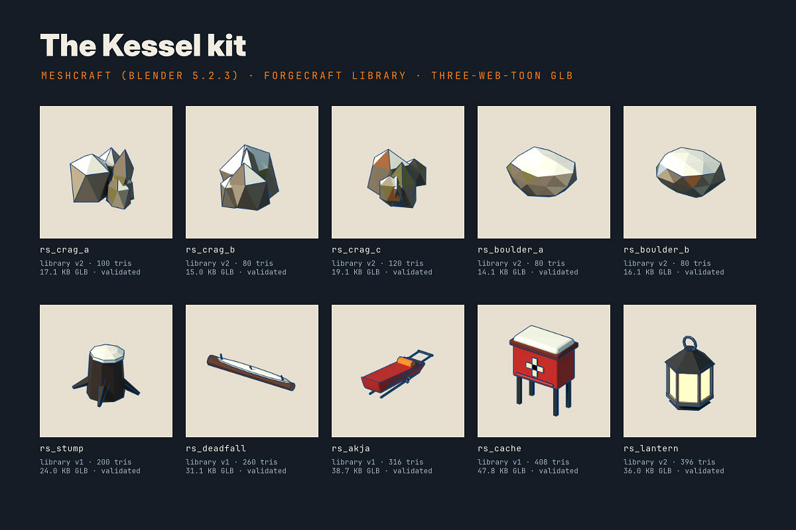
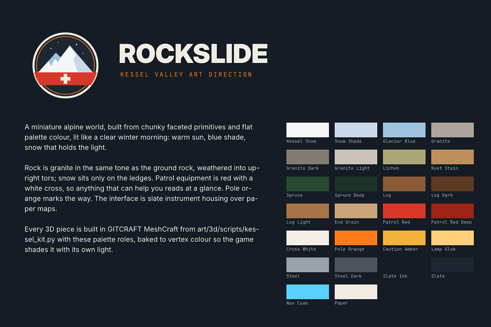
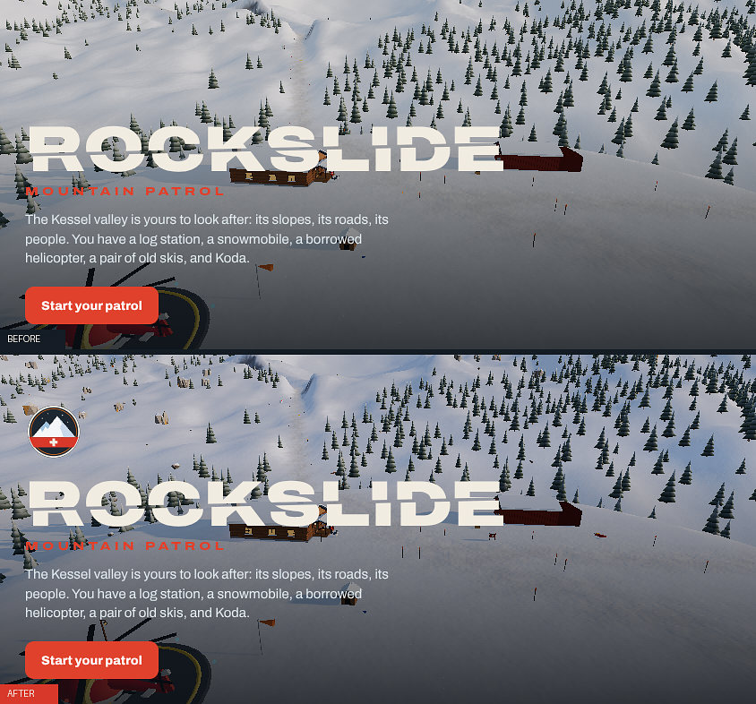
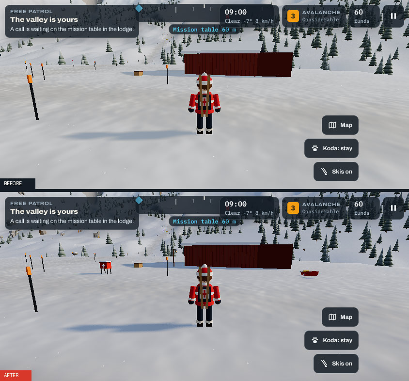
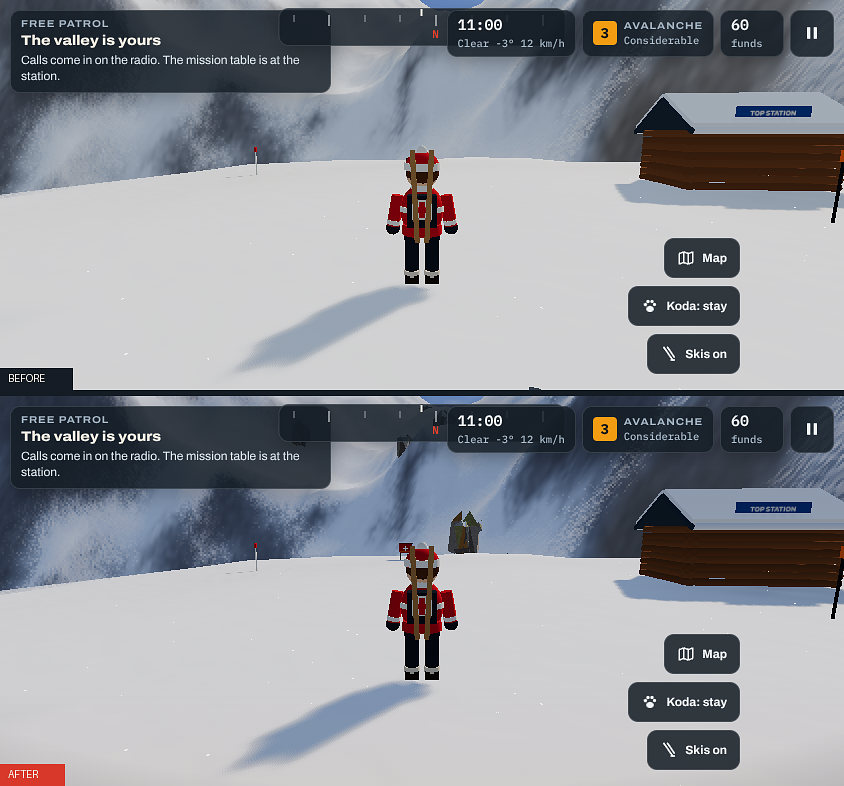
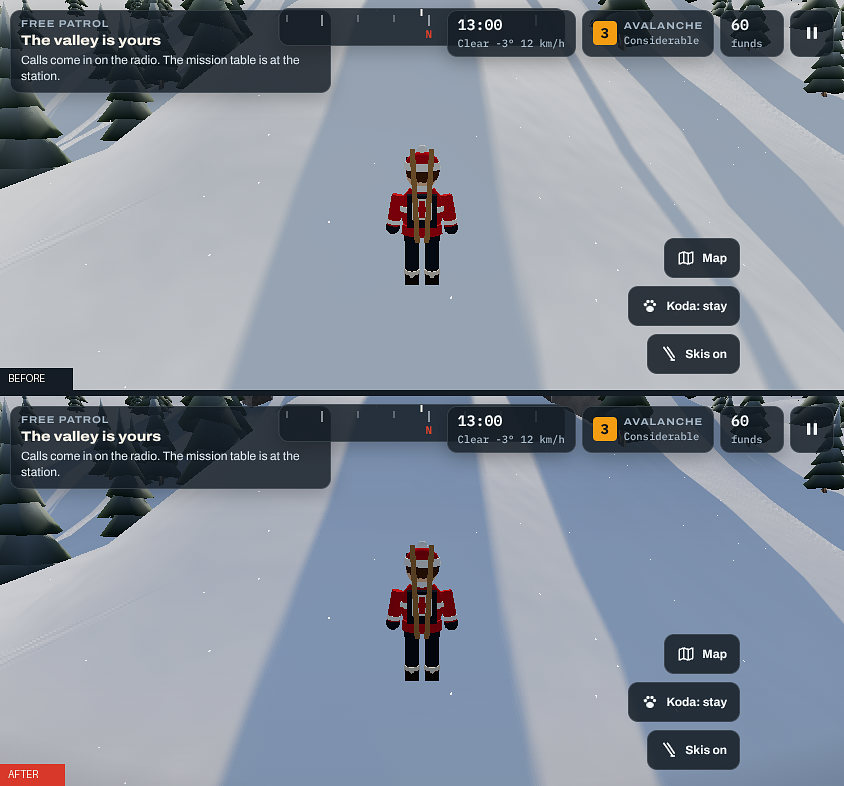
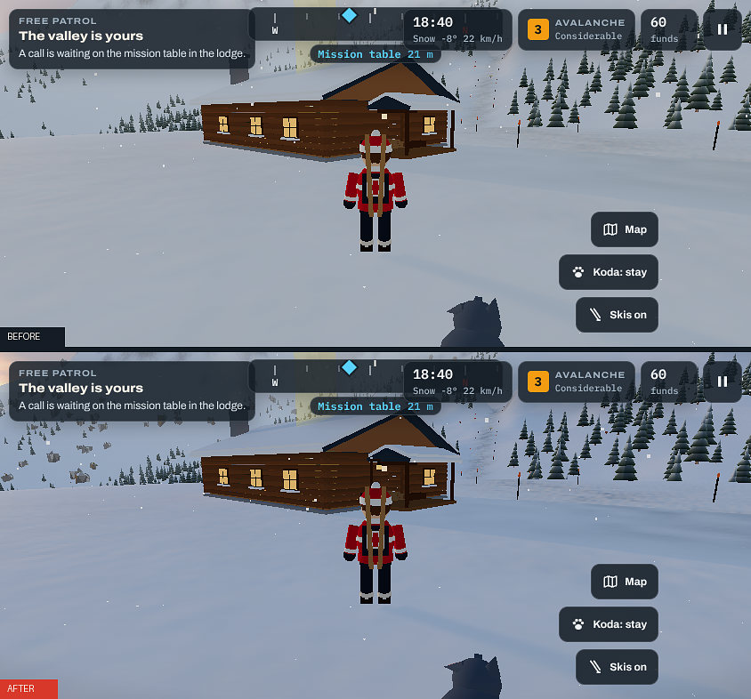
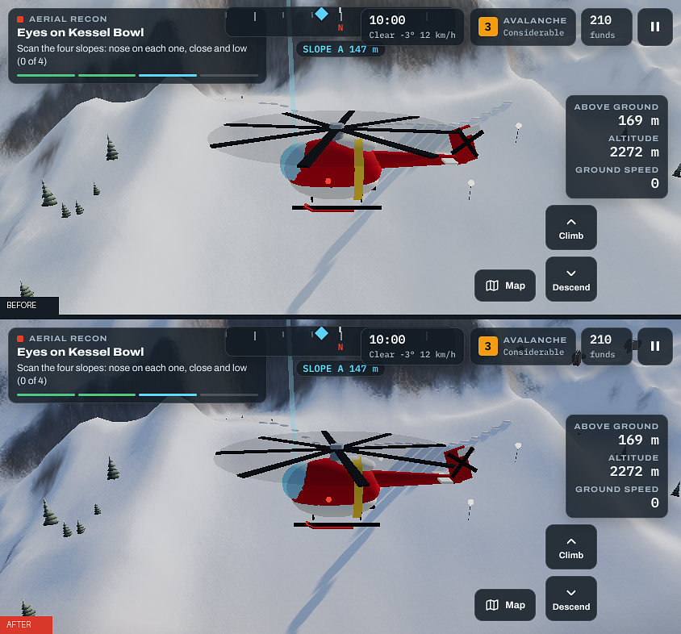
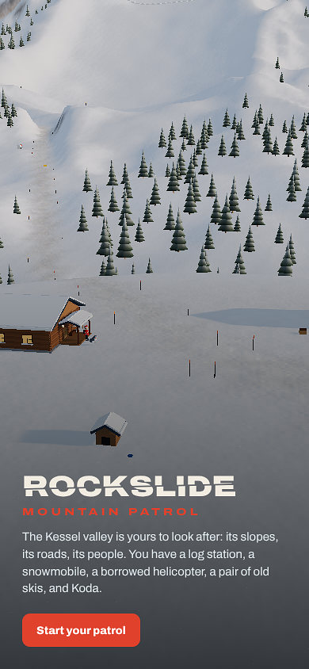
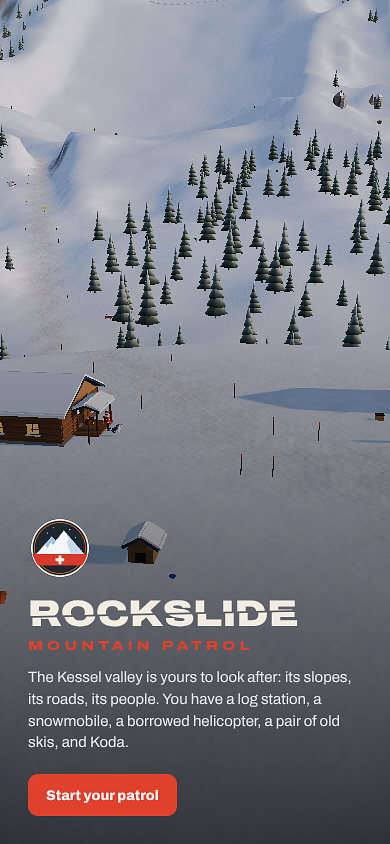

# ROCKSLIDE × GITCRAFT: production report

Branch `gitcraft-production-upgrade`. GITCRAFT used as an installed, unmodified toolchain
(`main` @ `e8835f3`, all nine MCP servers, Blender 5.2.3 LTS headless). Every tool call ran
through GITCRAFT's guard and Landlock sandbox (`scripts/mcp.sh`) and is logged with file
hashes in `~/.gitcraft/logs/audit.jsonl`.

The game is the same game: the same loop, missions, controls, progression, saves and
vehicles. What changed is the world you ride through, the light it sits in, and the
identity around it.

## 1. GITCRAFT tools discovered

| Server | Tools | What it offered Rockslide |
| --- | --- | --- |
| meshcraft | 30 | Blender modelling (`run_script`, 14 templates), previews, validation (incl. Khronos), export profiles (three-web-toon, LODs, collision), three.js engine check, library, manifests |
| forgecraft | 17 | Routing across MeshCraft / Blockbench / Mixamo / Meshroom / TripoSR / Hunyuan3D, library versions with provenance, hash-verified hand-off |
| vectorcraft | 33 | Vector illustration, SVG/PNG/PDF export |
| photocraft | 26 | Raster editing, resampling, encoding |
| designcraft | 26 | Page layout, PNG/PDF export |
| pdfcraft | 17 (+ compact) | PDF combine, inspect, search, render |
| lightcraft | 17 | Photo library, batch export |
| filmcraft | 17 | Non-linear video editing |
| effectcraft | 27 | Motion graphics and compositing |

Capability probe on this machine: MeshCraft, Blockbench I/O and Mixamo hand-off are available.
**TripoSR, Hunyuan3D and Meshroom are unavailable** (no GPU; huggingface.co unreachable from
the cloud sandbox). ForgeCraft's router confirmed that a text brief like "low-poly snowy granite
outcrop" would route to Hunyuan3D if it could. With that unavailable and no template matching,
hand-directed Blender (`run_script`) was the correct route.

## 2. Tools actually used

| Tool | Used for |
| --- | --- |
| **MeshCraft** | `run_script` (9 hand-directed builds from `art/3d/scripts/kessel_kit.py`, rebuilt 3× while art-directing), `render_preview`, `export_asset` (three-web-toon + LOD50/LOD25 + collision), `validate_asset` (scene checks + glTF structure + Khronos validator), `engine_check` (three.js r170 in headless Chromium), `run_pipeline` (lantern template with the Rockslide palette), `library_export`, `update_manifest`, `meshcraft_status`, `list_templates`, `list_profiles` |
| **ForgeCraft** | `route` (routing decision), `process_mesh` (each kit asset → MeshCraft child job → engine check → library version with provenance → hand-off), `library_export` (hash-verified hand-off of the final versions), `library_search` |
| **VectorCraft** | Drew the Kessel Patrol emblem (`file.new`, `draw_shape`, `draw_path`), saved `.vectorcraft`, exported SVG / PNG / PDF |
| **PhotoCraft** | Resampled the emblem into the icon set (`image.imageSize`, Lanczos / bicubic-sharper); re-encoded the share card PNG (857 KB) to JPEG (141 KB) |
| **DesignCraft** | Composed the 1200×630 share card (hero frame, gradient scrim, emblem, type); laid out the two-page art bible; exported PNG and PDF |
| **PDFCraft** | Combined the VectorCraft emblem PDF with the DesignCraft pages into `art/kessel-art-bible.pdf`; verified page count and live text |
| **LightCraft** | Imported the before/after captures and batch-exported the report images (`docs/production/*.jpg`) |

Hand-offs were files: MeshCraft `.blend` → GLB → ForgeCraft library → `public/models/`;
VectorCraft PNG → PhotoCraft icons and DesignCraft card → PhotoCraft JPEG; VectorCraft PDF + DesignCraft PDF → PDFCraft.

**Discovered, not used:** FilmCraft and EffectCraft (Rockslide ships no video or motion
graphics, and a trailer was not needed to improve the game itself). Blockbench and Mixamo
were not used either: no character was replaced, because the patroller, Koda, the sled and the
helicopter are tied into the game's customisation and animation code and work well.

## 3. Assets generated

| Asset | Tris | GLB | Library | Checks |
| --- | --- | --- | --- | --- |
| `rs_crag_a` granite tor | 100 | 17.1 KB | v2 | 13 pass, 0 warn, 0 fail; engine 3/3 |
| `rs_crag_b` tall tor | 80 | 15.0 KB | v2 | 13 / 0 / 0; 3/3 |
| `rs_crag_c` broken tor | 120 | 19.1 KB | v2 | 13 / 0 / 0; 3/3 |
| `rs_boulder_a` | 80 | 14.1 KB | v2 | 13 / 0 / 0; 3/3 |
| `rs_boulder_b` | 80 | 16.1 KB | v2 | 13 / 0 / 0; 3/3 |
| `rs_stump` | 200 | 24.0 KB | v1 | 13 / 0 / 0; 3/3 |
| `rs_deadfall` | 260 | 31.1 KB | v1 | 13 / 0 / 0; 3/3 |
| `rs_akja` rescue toboggan | 316 | 38.7 KB | v1 | 13 / 0 / 0; 3/3 |
| `rs_cache` rescue cache | 408 | 47.8 KB | v1 | 13 / 0 / 0; 3/3 |
| `rs_lantern` (template, `swing` clip) | 396 | 36.0 KB | v2 | 17 / 0 / 0; 3/3 incl. clip |

The 2D deliverables are the Kessel Patrol emblem (SVG, PNG, PDF, `.vectorcraft`), the icon set
(512, maskable 512, 192, 180, 32), the share card, the art bible PDF, the palette and the manifest.

## 4. Assets integrated

- **`public/models/*.glb`** (10 files, 265 KB raw / 73 KB gzipped), loaded at boot by
  `src/render/kitView.ts` with three's own GLTFLoader (no new dependency). The loading screen
  has a "Hauling up the rocks" stage, and a missing file is skipped with a warning.
- **Placement:** `src/world/scatter.ts` (pure data, deterministic). On the phone tier that is
  590 pieces (298 tors); on desktop 1,083 (447 tors). Tors sit on 25–52° ground in clusters; boulders on the
  open slopes; deadwood just outside the stands. Nothing goes on roads, pads, the lake or the
  avalanche path, or near any mission point, badge, charge spot or station spot (all tested).
- **Hand-placed patrol gear:** 3 akjas, 6 rescue caches, 5 lantern posts at the station, the
  top station, the pass barrier, the weather station, Fernhut and Kessel Ridge.
- **Solid:** tors, boulders, stumps, caches and lantern posts join the trees' collision grid.
  In a browser test, a snowmobile driven at a tor stopped 4.10 m from its centre, which is its
  3.0 m radius plus the sled's 1.1 m.
- **Rendering:** each piece's base is draped onto the slope under it, so a tor on a steep
  face is neither buried uphill nor floating downhill. One vertex-colour material shades the
  whole kit with the game's own toon banding, granite grain and camera fade. Pieces merge per
  500 m tile (16 draw calls for the valley). Lanterns keep their node tree to play MeshCraft's
  swing clip and glow at dusk.
- **Brand:** `public/icons/*`, `public/favicon.svg`, `public/og-image.jpg` (replaces the stale
  `og-image.png` from the old boulder game: "Keep it together. Get to the bottom.").
  `index.html` metadata is updated. The emblem appears on the loading screen and the title.
- **Removed:** `public/og-image.png` (superseded) and `scripts/brand-assets.mjs` (rendered the
  old boulder card; unreferenced). Nothing else was removed.

## 5. Major visual improvements

| | Before | After |
| --- | --- | --- |
| Slopes | One unbroken white sheet; rock only as ground colour | Granite tors, boulders and deadwood give the slopes scale and structure |
| Patrol presence | The station and the vehicles | Rescue caches, akjas and lanterns where trouble happens |
| Sky | Flat gradient | Drifting cumulus banks (thicker in bad weather), warm horizon glow on the sun side, sun halo |
| Light | Bright, flat fill | Cooler, slightly lower sky fill and a stronger sun: shadows read blue, sun reads warm |
| Lens | None | Vignette and a cool-sky / warm-snow grade composited by the browser, closing in at night and in storms |
| Identity | Icon and share card from the retired boulder game | Kessel Patrol emblem across the icon, favicon, share card, loading screen and title |

Portrait title, before and after:

 

## 6. Gameplay improvements

- **Obstacles with consequences:** the new rocks and stumps are solid for the walker, the
  sled and the skis, through the existing bump physics (sound, camera kick and, on the sled,
  a powder puff).
- **Visible ski impacts:** skis now throw snow on a bump too (before, only sound and a kick).
- **Navigation cues:** rescue caches and lanterns mark the places missions send you (the top
  station, the pass barrier, the weather station, Fernhut, the ridge).
- **Unchanged on purpose:** missions, steps, rewards, progression, controls, saves, the
  avalanche simulation, vehicles and customisation.

## 7. Performance impact

Measured with `scripts/perf.mjs` on the same machine and views, before (`main`) vs after.
The renderer is SwiftShader (software), so frame times are relative only and noisy.
**Not measured on a physical phone.**

| Phone tier (low) | Draw calls | Triangles | Median frame |
| --- | --- | --- | --- |
| Station yard | 500 → 534 | 407k → 457k (+12%) | 229 → 248 ms |
| Top station | 200 → 220 | 161k → 183k (+14%) | 115 → 116 ms |
| Pass road | 179 → 186 | 150k → 167k (+11%) | 100 → 104 ms |
| Kessel Ridge | 178 → 173 | 111k → 127k (+14%) | 76 → 80 ms |

| Desktop tier (high) | Draw calls | Triangles | Median frame |
| --- | --- | --- | --- |
| Station yard | 452 → 487 | 620k → 727k | 675 → 695 ms |
| Top station | 203 → 224 | 303k → 361k | 330 → 291 ms |
| Pass road | 174 → 156 | 221k → 282k | 259 → 219 ms |
| Kessel Ridge | 178 → 186 | 165k → 212k | 157 → 164 ms |

- Kit shadow casting is desktop-only: casting whole 500 m tiles into the shadow pass cost a
  phone about 10% more triangles for little visible gain. Phones still receive shadows on rocks.
- JS bundle: 816.6 → 914.3 KB raw (226.5 → 253.9 KB gzipped), from three's GLTFLoader.
- Models: +265 KB raw (73 KB gzipped), fetched in parallel at boot. Boot to playable was
  within noise of before (2.5–4.8 s here). JS heap is +11 MB (phone) / +17 MB (desktop).
- Share card: 215 KB → 141 KB.

## 8. Test results

| Suite | Result |
| --- | --- |
| Rockslide `npm run check` (typecheck, vitest, production build) | **pass**: 54/54 tests (45 existing + 9 new in `tests/kit.test.ts`) |
| Rockslide `scripts/play.mjs` gameplay tour (landscape + portrait: lodge, yard, mission table, sled ride, recon flight) | **pass**, no page errors |
| Rockslide `scripts/showcase.mjs`, before and after, landscape and portrait | **pass**, no page errors |
| Rockslide sled-into-tor collision (browser) | **pass**: stopped at radius + sled radius. Boulder run inconclusive (the sled slid off-line on the slope) |
| GITCRAFT `tests/test_policy.py` | **pass**: 28/28 |
| GITCRAFT `tests/test_forgecraft.py` | **pass**: 37/37 |
| GITCRAFT `tests/test_meshcraft.py` | **pass**: 59/59 |
| MeshCraft validation, every asset | 13/13 (lantern 17/17) pass, 0 warn, 0 fail, Khronos validator included |
| MeshCraft engine check (three.js r170), every asset | 3/3 pass (load, COLOR_0, base on ground; lantern clip) |
| PDFCraft verification of the art bible | 3 pages, text searchable |

New tests: every model ships and loads with COLOR_0 on every mesh, grounded and centred,
within a triangle budget, with no black or missing colours. Placement is deterministic, tors
sit on steep ground, and nothing lands on pads, routes, the lake, the avalanche path, a
badge, a charge spot or a station spot. Patrol props stay outside every wall and off every
route; rocks are in the collision grid. There is also a regression test for interleaved,
normalised glTF attributes.

## 9. Remaining issues

- **Not tested on a physical phone.** Phone numbers are from an emulated iPhone viewport on
  software rendering. Worth a real-device check, especially the CSS blend layer on older iPhones.
- **Library hygiene (local, not in this repo):** the first ForgeCraft re-ingest of the
  re-coloured rocks omitted `asset_id`, creating nine stray `rs_*_2` assets in the local 3D
  library. The shipped files are the proper v2 versions; the saved pipeline script is fixed.
- MeshCraft exports one glTF primitive per palette role, so the game merges them at load.
  This is cheap, but a single-primitive profile would save the work.
- GLTFLoader could be split into a lazily loaded chunk to win back ~27 KB gzipped of first-load JS.
- Lanterns glow (emissive) but cast no light: real point lights cost too much on phones.
- The share card uses Inter Display and JetBrains Mono: the game's Archivo and IBM Plex Mono
  are web fonts the offline sandbox can't load.
- In the art bible, the swatch hex codes overflow their caption frames (the names show; the
  palette JSON has the values).
- Optional ideas, not done: a trailer (FilmCraft + EffectCraft), Blockbench-editable versions of
  the props, a hero redesign of the helicopter and sled (they work and carry the customisation
  system, so they were left alone).

## 10. Before/after renders

All images in this folder: `cmp-*.jpg` (before on top, after below, same camera, same time
of day), the portrait title pair, the kit contact sheet and the art direction page.
`scripts/showcase.mjs` reproduces every pair against any two builds.
